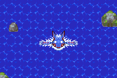
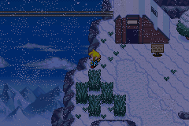
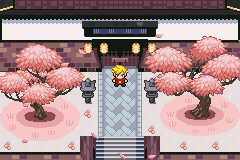
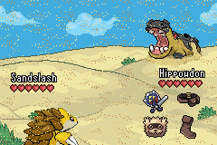

## What is Samiya?

Pokemon Samiya is a romhack of Emerald Version that aims to bring a Zelda-like experience into the world of Pokemon. It takes place as a sequel to Pokemon Sapphire where Team Aqua is victorious and manages to flood Hoenn. 

The story is set 1,000 years after the flood in this Sunken Hoenn and uses that as a jumping off point for the **Wind Waker** crossover. But despite the heavy Wind Waker and Zelda influences, the hack is still largely grounded in the Pokemon world, with the events of the **Pokemon Ranger and the Temple of the Sea** movie heavily inspiring the greater plot of the romhack. 

Explore The Great Sea and find the hidden mysteries of this completely transformed region! 

---

## Important Details

 Features and Content 

- A full new region, with all new maps, scripts, NPCs, quests, story, etc
- A new overworld engine featuring Zelda mechanics like the Bow, Bombs, Hookshot, and more
- A decent sized post game searching for various legendary Pokemon of the series
- A complete overhaul to all the UIs in the game as well as many custom ones
- A dozen minigames added to the game in various parts of the region
- All new fullscreen animated cutscenes 
- This hack has many modern features you would expect in a typical 2020's romhack but not everything is traditional
- Samiya is based on the pokeemerald-expansion v1.14 so it contains most of the modern battle features, however, many things are custom

Frequently Asked Questions

  #### How do I download this game?

  - Upload your copy of the vanilla Pokemon Emerald (USA, EUROPE) ROM file to the button in the DOWNLOAD category lower down this page and hit the patch button.

  #### Where are the docs?

  - There are no official docs for Pokemon Samiya. I encourage you to play through the game without them at least through the main story the first time you play. I am fine with player made docs being created and encourage it if they're human driven. I don't support AI scraped docs because its just kinda lame and boring, but the AI bros who do that stuff don't really care about how boring that is so they will undoubtably do it anyway. That's life in the 21st Century now.

  #### Who is this crossover made for?

  - In an ideal world this hack would be made for everyone with game design decisions that reflect that, but in reality the decisions made in the interest of pushing one aspect of gaming will always have an effect on other aspects, and the things some people find fun versus others are not the same. This hack was made for Zelda fans who also like Pokemon, not Pokemon fans who also like Zelda or Pokemon fans who don't care for Zelda at all. It is not nuzlocke friendly for a number of intentional and unintentional game design decisions. It is very non-traditional and does not follow the typical formula of a typical Pokemon game. So keep that in mind before and while playing it. 

 #### Will the Source Code be Released / Can We Make Mods of Samiya?

 - The goal is to release the source code with the 6 month anniversary of the hacks release alongside hopefully the last major bug fix/balance patch. 

 - I absolutely encourage people to make mods of Samiya, but I request that you don't release any alternative public downloads for the project until at least the 6-month patch is out (which this text will be updated at that time), just so that there aren't fan patches floating around on older outdated versions. I obviously can't stop anyone from shitting out an AI update a day after launch, but out of respect for the ***YEARS*** of work put into this project I hope people can at least hold off until the post launch bug fix patches are finished. 

Patches / Updates 

- This game isn't even out yet nerd.

Known Issues

- Yo Mama Fat

---

## Hack Showcase

---
